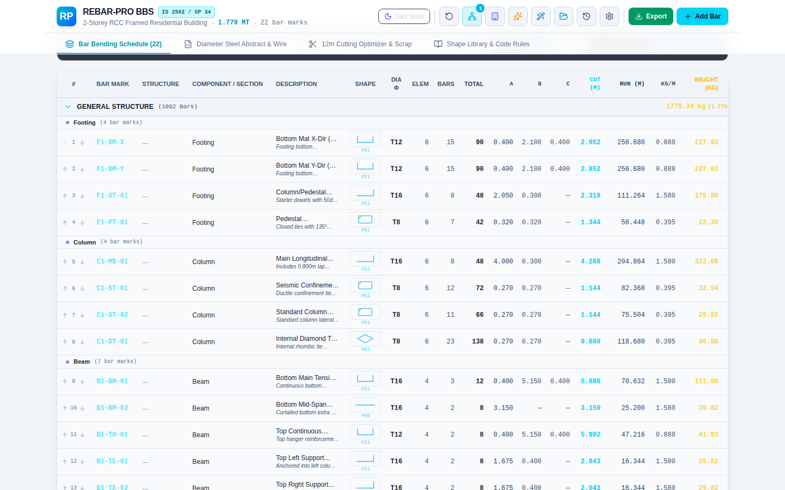
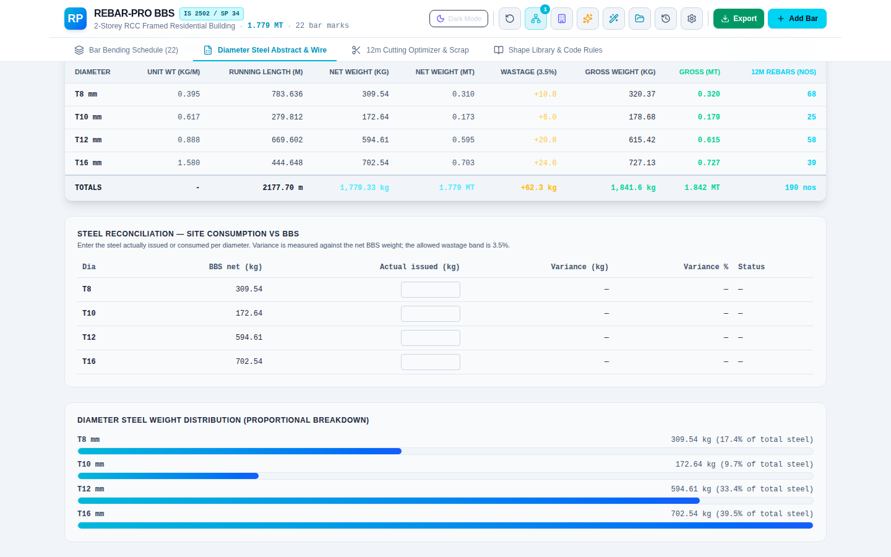
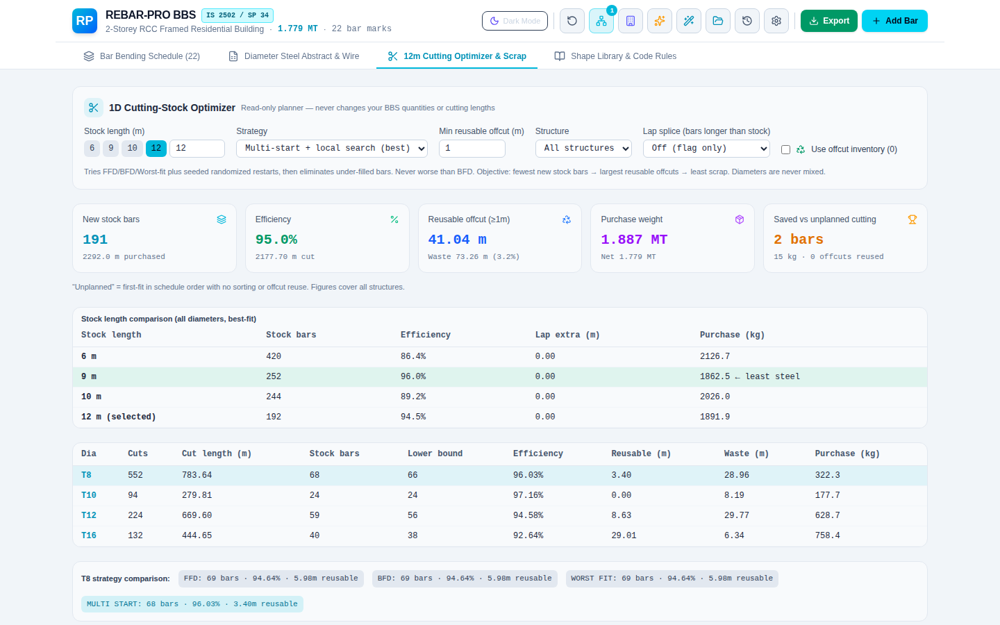

# REBAR-PRO — BBS & Cutting Optimizer

Bar Bending Schedules and cutting-stock optimization for civil engineers. Runs entirely in your browser — no backend, no account, no API key.

**[Open the live app →](https://ghostship25.github.io/Rebar-Pro/)**



## Features

**Schedule**
- IS 2502 / SP 34 and BS 8666 shape codes, member wizards, section templates, custom shapes
- Per-bar **Show calculation** (inputs, formula, hooks, bend deductions, weight)
- CSV export, CSV import and paste from Excel (mm or m)
- **DXF export** (AutoCAD-compatible schedule table with schematic bar sketches)
- Revision history with diff and restore

**Site & procurement**
- Printable bar-mark tags and yard cut list by diameter and cutting length
- Steel abstract with wastage, binding wire and cost (rate per kg)
- Steel reconciliation: actual issued steel vs BBS per diameter
- Excel, PDF and print reports with company logo and header/footer notes



**Optimizer**
- 1D cutting-stock planner with offcut reuse and optional lap splicing (40d–60d)
- Stock-length comparison (6 / 9 / 10 / 12 m) to find the least-steel option



## Quick start

Requires Node.js 18+.

```bash
npm install
npm run dev        # http://localhost:3000
npm run build      # production build
npm run lint       # type-check
```

## Privacy & security

- Data stays in your browser (`localStorage`). Use **Export → Save Project File (.bbs)** to back up or share.
- No `eval`; custom formulas use a safe parser. Imports are size-limited and validated.
- Production build ships a Content Security Policy; Dependabot keeps dependencies current.

## Deployment

Pushes to `main` deploy to GitHub Pages via GitHub Actions (**Settings → Pages → Source: GitHub Actions**). You can also run the *Deploy to GitHub Pages* workflow manually.

## Roadmap

- ACI 318 and AS 3600 shape/hook/lap rules (pending verified code tables)
- Dimensioned, to-scale DXF bar sketches; Revit export
